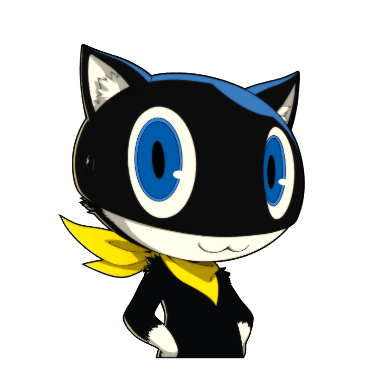

# `takamaki-3d.html` 逐行解释

下面为 `takamaki-3d.html` 的逐行/逐段解释，便于查阅与维护。

1. <!doctype html> — 声明 HTML5 文档类型。
2. <html lang="zh-CN"> — 根元素，页面语言为简体中文。
3. <head> — 文档头部开始。
4. <meta charset="UTF-8" /> — 指定字符编码为 UTF-8。
5. <meta name="viewport" content="width=device-width, initial-scale=1.0" /> — 响应式视口设置。
6. <title>火箭射击</title> — 浏览器标签标题“火箭射击”。
7. <link rel="stylesheet" href="../../../shared/p5ui/css/p5-ui.css" /> — 引入全局 p5-ui 样式库。
8. <link rel="stylesheet" href="../../shared/site.css" /> — 引入站点共享样式。
9. <link rel="stylesheet" href="../../player4/characters.css" /> — 引入人物页相关样式（复用）。
10.  — 内联样式结束。
75. </head> — 头部结束。
76. <body class="p5r-characters" data-p5r-page="player2-canvas-game"> — 页面主体，类与 data 属性用于样式/脚本识别。
77. <header class="p5r-header p5r-header--solid" role="banner"> — 页面头部（导航）开始。
78.   
 — 头部左侧容器。
79.      — logo 图片。
80.   
 — 左侧结束。
81.   
 — 头部右侧，导航/用户区域开始。
82.     <nav class="p5r-header__nav" aria-label="委托、公告、联系与人物"> — 主导航，含多组下拉（details）。
83.       
 — 第一个下拉：委托。
84.         
 — summary 作为触发按钮。
85.           委托 — 按钮文本。
86.            — caret 图标（装饰）。
87.         

88.         
 — 下拉面板组。
89.           <a class="p5-btn-ctn p5-hover-animation-gray p5r-headerNav__item" href="../../player3/pages/requests.html">委托</a> — 链接到请求页。
90.           <a class="p5-btn-ctn p5-hover-animation-gray p5r-headerNav__item" href="../../player3/pages/my-missions.html">我的任务</a> — 我的任务。
91.         

92.       

93.       <a class="p5-btn-ctn p5-hover-animation-gray p5r-bulletinNavSolo" href="../../player1/pages/bulletins.html">公告</a> — 单独的公告链接。
94.       
 — 第二个下拉：联系/小游戏。
95.         

96.           联系
97.           
98.         

99.         

100.           <a class="p5-btn-ctn p5-hover-animation-gray p5r-headerNav__item" href="contact.html">联系</a> — 本地联系页。
101.           <a class="p5-btn-ctn p5-hover-animation-mix p5r-headerNav__item is-current" href="takamaki-3d.html" aria-current="page">小游戏</a> — 当前页面链接，标记为当前页。
102.         

103.       

104.       
 — 第三个下拉：人物相关。
105.         

106.           人物
107.           
108.         

109.         

110.           <a class="p5-btn-ctn p5-hover-animation-gray p5r-headerNav__item" href="../../player4/pages/characters.html">人物</a>
111.           <a class="p5-btn-ctn p5-hover-animation-gray p5r-headerNav__item" href="../../player4/pages/photo-stage.html">照片舞台</a>
112.           <a class="p5-btn-ctn p5-hover-animation-gray p5r-headerNav__item" href="../../player4/pages/book-flip.html">人物画册</a>
113.           <a class="p5-btn-ctn p5-hover-animation-gray p5r-headerNav__item" href="../../player4/pages/card-draw.html">卡片抽取</a>
114.         

115.       

116.     </nav> — 主导航结束。
117.     
 — 用户区域开始（个人中心、退出、用户名）。
118.       

119.         <a id="profileEntry" class="p5-btn-ctn p5-hover-animation-gray" href="../../player4/pages/profile.html">个人中心</a> — 个人中心链接。
120.         

121.           <button type="button" class="p5-btn-ctn p5-hover-animation-gray p5r-headerNav__item p5r-headerUserMenu__btn" data-p5r-logout>退出</button> — 退出按钮，带 data 属性供脚本绑定。
122.         

123.       

124.       游客 — 显示用户名，默认“游客”。
125.     
 — 用户区域结束。
126.   
 — 头部右侧结束。
127. </header> — 头部结束。
128.
129. <main class="p5r-photoStageMain p2-cvg-main" aria-label="火箭射击"> — 主要内容区（游戏舞台），含可访问标签。
130.   
得分：0　最高：0
 — 分数显示，`aria-live` 便于屏幕阅读器读出更新。
131.   
 — 工具栏，包含开始/暂停/重置按钮。
132.     <button type="button" class="p5-btn-ctn p5-hover-animation-mix" id="p2CvgStart">开始 / 继续</button> — 开始或继续按钮。
133.     <button type="button" class="p5-btn-ctn p5-hover-animation-gray" id="p2CvgPause">暂停</button> — 暂停按钮。
134.     <button type="button" class="p5-btn-ctn p5-hover-animation-gray" id="p2CvgReset">重新开始</button> — 重新开始按钮。
135.   

136.   
 — 画布外壳。
137.     <canvas id="p2CvgCanvas" class="p2-cvg-canvas" width="360" height="420" aria-label="火箭射击"></canvas> — Canvas 元素，初始像素尺寸 360x420（脚本会根据 DPR 调整实际分辨率）。
138.   

139. </main> — 主区域结束。
140.
141. 

 — 通知宿主（供脚本插入通知）。
142. 
 — 隐藏的通知模板（复用）。
143.   
 — 模板内容开始。
144.      — 模板头像（装饰）。
145.     
 — 气泡容器。
146.        — 气泡背景图。
147.       

148.         
摩尔 加纳
 — 通知标题（发送者名）。
149.       

150.       
通知示例
 — 通知正文占位。
151.     

152.   

153. 
 — 通知模板结束。
154. 
 — 回到顶部控件（初始 hidden）。
155.   
156. 

157.
158.  — 引入共享脚本，包含页面通用行为与 P5Proto 等（若定义）。
159.  — 内联脚本结束。
547. </body> — body 结束。
548. </html> — HTML 文档结束。

---

如果你想，我可以：
- 将此解释拆分为更小节（CSS / HTML / JS）并添加索引；
- 把注释直接写回 `takamaki-3d.html`（嵌入简短注释）；
- 或把部分函数做更深入逐行注释（比如碰撞检测或性能优化）。
